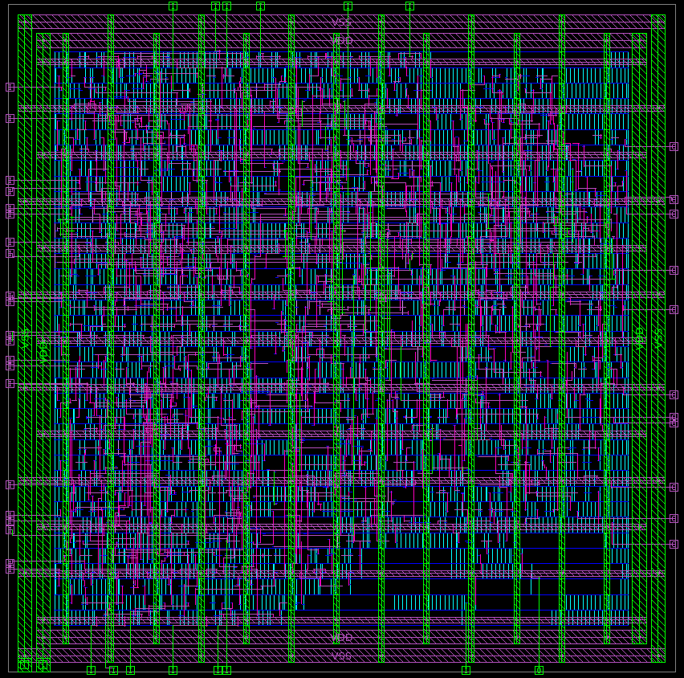
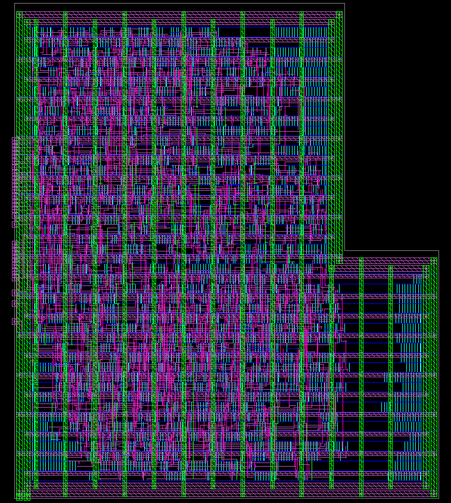
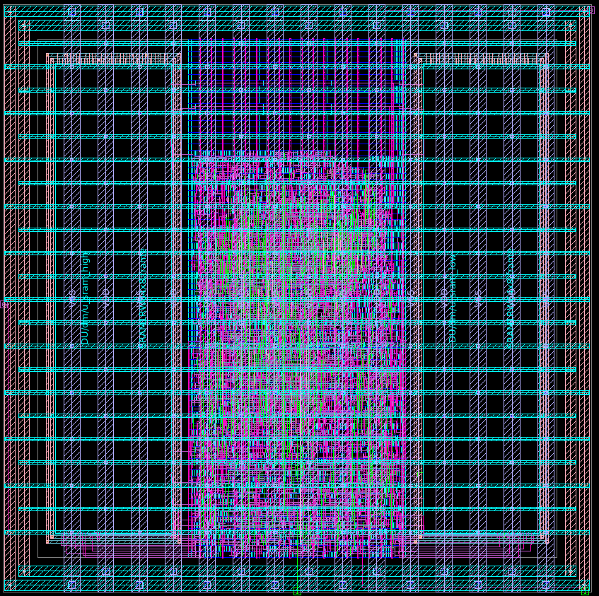
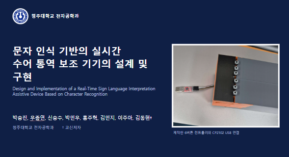
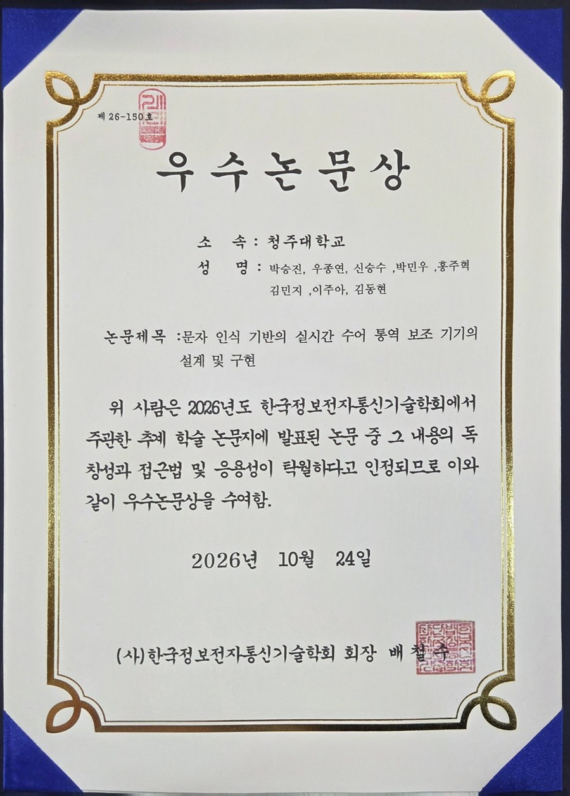

# ASIC Design Portfolio

RTL 합성부터 배치·배선, 타이밍 분석, DRC·LVS 검증까지 직접 진행한 프로젝트를 정리했습니다.

- 청주대학교 전자공학과 (2027.02 졸업 예정)
- AI 기반 설계 시스템을 활용한 시스템반도체 설계 (KDT, 2026.04 ~ 2026.11)
- Contact: dnwhddus123@gmail.com

## Design Flow

| 단계 | Tool |
|---|---|
| RTL 검증 | VCS |
| 합성 | Design Compiler |
| 배치·배선 | ICC2 |
| 타이밍 분석 | PrimeTime |
| DRC·LVS 검증 | ICV |

공정 라이브러리: Synopsys SAED 32nm 교육용 라이브러리

## Projects

| Project | 구조 | 목표 주파수 | WNS | Cell 수 |
|---|---|---|---|---|
| [Error Detection](#1-error-detection) | 파이프라인 오류 검출 회로 | 854 MHz | −0.00032 ns | 810 |
| [CISC](#2-cisc-processor) | 8비트 폰 노이만 구조 프로세서 | 714 MHz | −0.01662 ns | 731 |
| [RISC](#3-risc-processor) | 하버드 구조, SRAM 하드 매크로 | 500 MHz | +0.55 / −0.18 ns (1.16V / 0.78V) | 1781 |

Error Detection과 CISC의 WNS 허용 기준은 −0.05 ns 이상입니다.

---

### 1. Error Detection

입력값의 최댓값과 최솟값을 비교해 오류를 검출하는 파이프라인 회로입니다.

**What I did**
- VCS simulation으로 RTL 기능 검증
- Design Compiler 합성 → ICC2 배치·배선

| 목표 주파수 | WNS | Cell 수 |
|---|---|---|
| 854 MHz | −0.00032 ns | 810 |

---

### 2. CISC Processor

명령어와 데이터를 하나의 메모리에 저장하는 폰 노이만 구조의 8비트 CISC 프로세서입니다. FSM이 fetch, decode, execute 단계를 순서대로 제어하며, 메모리에 저장된 명령어로 피보나치 수열을 계산합니다.

**What I did**
- VCS simulation으로 피보나치 연산 결과 검증
- Design Compiler 합성 → ICC2 배치·배선 → PrimeTime 타이밍 확인

| 목표 주파수 | WNS | Cell 수 |
|---|---|---|
| 714 MHz | −0.01662 ns | 731 |

---

### 3. RISC Processor

명령어 메모리와 데이터 메모리를 분리한 하버드 구조의 16비트 RISC 프로세서이며, 데이터 메모리에 SRAM 하드 매크로를 적용했습니다.

**What I did**
- VCS simulation으로 피보나치 연산 결과 검증
- Design Compiler 합성 → ICC2 배치·배선 → PrimeTime 타이밍 확인
- SRAM 매크로 배치와 전원 연결, ICV로 DRC·LVS 검증

**Multi-corner timing**
- 1.16V 코너에서 타이밍을 먼저 맞춘 뒤, 0.78V 저전압 코너에서도 같은 경로를 분석했습니다.
- SRAM 주소 경로가 1.16V에서는 +0.55 ns 여유가 있었지만, 0.78V에서는 위반되었습니다.
- PrimeTime `-through` 옵션으로 두 코너의 같은 경로를 맞춰 비교해, ALU를 거쳐 SRAM 주소로 들어가는 조합 경로 지연과 SRAM 쪽 클럭 도착 시간 차이가 원인임을 확인했습니다.

**DRC (ICV)**
- 에러마다 GUI에서 위치를 확인해 수정할 에러와 waiver로 둘 에러를 나눴습니다.
- M1.W.2.1: 기준값 0.06보다 좁은 0.058 간격 → via 배열을 1×2에서 1×1로 바꾸고 위치를 조정해 해결
- VIA3.B.1: SRAM 매크로 내부 에러로 수정할 수 없어 waiver 처리

| 목표 주파수 | WNS (1.16V / 0.78V) | Cell 수 |
|---|---|---|
| 500 MHz | +0.55 / −0.18 ns | 1781 |

---

## Award

**한국정보전자통신기술학회 2026 추계 학술대회 우수논문상**
문자 인식 기반의 실시간 수어 통역 보조 기기의 설계 및 구현 (공동 저자)

- 담당: 손 랜드마크 기반 지문자 인식 코드, ATmega128 6버튼 입력 컨트롤러 (외부 인터럽트, UART)

 
